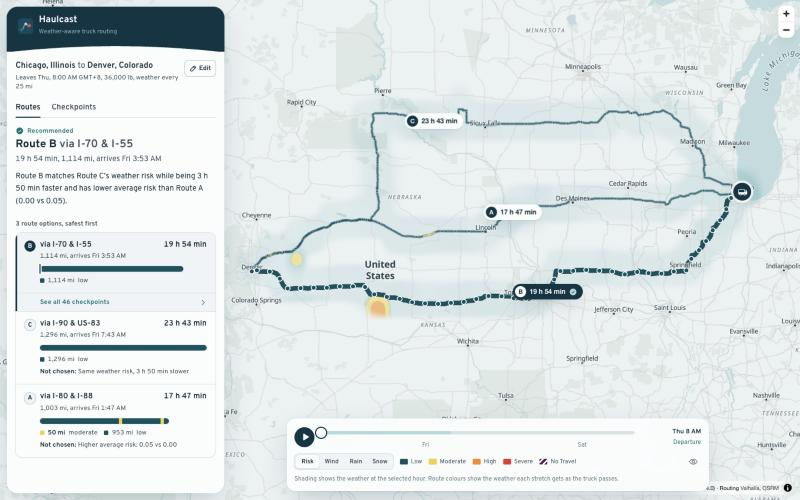
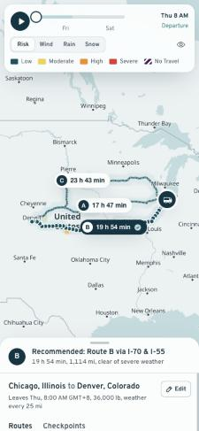
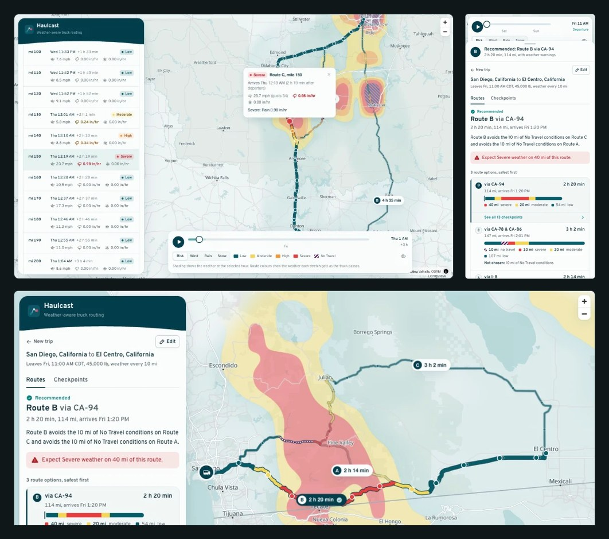
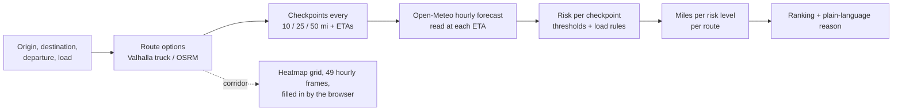

# Haulcast: weather-aware truck routing

**Live app: [haulcast.vercel.app](https://haulcast.vercel.app)**

A React + Django app that helps a truck driver choose the safest route. It finds three
route options, reads the forecast at every checkpoint **for the moment the truck will be
there**, scores wind, rain and snow against the brief's risk and load rules, and recommends
the route with the least dangerous weather, explaining why in plain language. A 48-hour
weather heatmap along the corridor shows how conditions move while the truck is on the road.





**Highlights**

- **Three genuinely different routes**: truck routing (Valhalla) with the load's weight,
  plus generated detours when the router returns fewer than three.
- **Weather at the truck's ETA**: checkpoints every 10, 25 or 50 miles, each read at its
  own arrival time.
- **Risk exactly per the brief**, with every boundary pinned by tests, including the
  load rules for heavy trucks.
- **Recommendation you can check**: fewest No Travel, then Severe, then High miles, then
  lowest average risk, then shortest time, with the reason for each route spelled out.
- **A smooth WebGL heatmap**: 49 hourly frames live on the GPU, so the 0–48 h slider
  scrubs and plays at 60 fps with no network or React work.
- **Keyless**: OpenStreetMap routing, Open-Meteo forecasts and OpenFreeMap tiles. Clone
  it and run it.

<br clear="right">

**In real weather.** A storm over the mountains east of San Diego, planned live for a
45,000 lb load. Route B avoids both No Travel stretches. The heatmap shows the storm's
shape, and each checkpoint says when the truck gets there and what it will meet (here,
0.98 in/hr of rain: Severe).



## Contents

1. [Quick start](#quick-start)
2. [How a plan is made](#how-a-plan-is-made)
3. [Risk rules and recommendation](#risk-rules-and-recommendation)
4. [The heatmap](#the-heatmap)
5. [Architecture](#architecture)
6. [API](#api)
7. [Design](#design)
8. [Quality](#quality)
9. [Live data check](#live-data-check)
10. [Deployment](#deployment)
11. [Assumptions and limits](#assumptions-and-limits)

More detail: [design record](docs/DESIGN.md) (requirement-by-requirement) and the
[walkthrough script](docs/WALKTHROUGH.md).

## Quick start

Requirements: Python 3.12+ with [uv](https://docs.astral.sh/uv/), Node 20.19+.

```bash
# API on http://127.0.0.1:8000
cd backend
uv sync
DJANGO_DEBUG=1 uv run python manage.py runserver

# Web app on http://localhost:5173 (proxies /api to the API)
cd frontend
npm install
npm run dev
```

Open the app and pick a sample trip, or type an origin and destination. No API keys or
database are needed. Every trip is a URL, so plans are shareable links.

| Command | Where | What |
| --- | --- | --- |
| `uv run pytest` | `backend/` | 138 tests: risk boundaries, ranking, geometry, rate limits, heatmap bytes, API with faked services |
| `uv run ruff check . && uv run mypy planner config` | `backend/` | Lint and strict type-check |
| `npm test` | `frontend/` | 99 tests: thresholds, heatmap packing and sampling, geometry, URL state, retries, UI |
| `npm run lint && npm run build` | `frontend/` | ESLint (strict, type-aware), type-check, production build |
| `npm run test:e2e` | `frontend/` | Playwright tests in Chromium, network stubbed (first: `npx playwright install chromium`) |

## How a plan is made



1. **Routes.** Trips up to 800 miles straight-line use Valhalla's **truck** costing with the
   truck's gross weight (load + 35,000 lb tare), so roads closed to heavy trucks are
   avoided. The public Valhalla server rejects anything over 1,500 km, so longer trips use
   OSRM. Both plan the truck at no more than 65 mph: Valhalla is sent that top speed (its
   truck default is 75 mph), and OSRM's car timings are slowed to it on every road
   segment, so ETAs don't depend on which engine planned the trip. The router's own
   alternatives come first. If it returns fewer than three, Haulcast routes through a via
   point offset to either side of the fastest route's midpoint. A detour is kept only if
   it:
   - is at most 1.5× slower than the fastest route;
   - overlaps every other option by no more than 70%;
   - has no U-turns and doesn't double back on itself.

   If the geography allows only two real options, the app shows two and says so rather
   than padding with a near-copy.
2. **Checkpoints and ETAs.** A checkpoint sits every 10, 25 or 50 miles from the origin,
   plus one at the destination. The router's per-maneuver timings give the truck's
   elapsed time at every mile, so each checkpoint has its own ETA.
3. **Weather at the ETA.** Open-Meteo's hourly forecast is read at each checkpoint's ETA:
   - *Wind:* an instantaneous value, interpolated between the surrounding hours.
   - *Rain and snow:* hourly totals, so the app uses the hour the truck is driving
     through. Rain is `rain + showers` (liquid only); snow is `snowfall` in inches.

   Lookups are snapped to a 0.05° lattice (≤ 3.5 km, finer than the forecast models),
   de-duplicated across routes, batched 150 per request and cached for 30 minutes. The
   window starts at the departure's 6-hour UTC block and covers at least the heatmap's 48
   hours, so the plan can fill in the heatmap's cells at its checkpoints, and other
   intervals and nearby departures reuse the same forecasts (see
   [Assumptions and limits](#assumptions-and-limits)).
4. **Risk, exposure, recommendation.** See below.

## Risk rules and recommendation

Thresholds per checkpoint, straight from the brief:

| Condition | Low | Moderate | High | Severe | No Travel |
| --- | --- | --- | --- | --- | --- |
| Wind (mph) | < 25 | 25–34 | 35–44 | 45–54 | ≥ 55 |
| Rain (in/hr) | < 0.10 | 0.10–0.25 | 0.25–0.50 | 0.50–1.00 | > 1.00 |
| Snow (in/hr) | < 0.5 | 0.5–1.0 | 1.0–2.0 | 2.0–3.0 | > 3.0 |

Load rules: ≥ 55 mph is No Travel for any load; 45–54 mph with **more than** 30,000 lb is
No Travel; 35–44 mph with **more than** 40,000 lb is Severe.

**Edge cases, decided explicitly** ([`risk.py`](backend/planner/domain/risk.py)):

- **Shared band edges.** The table's bands share endpoints (0.25 is in both Moderate and
  High), so each band's lower bound is inclusive and the shared value takes the higher
  band: 0.25 in/hr is High, 35 mph is High.
- **Whole-number wind bands** are continuous half-open ranges: 34.6 mph is Moderate.
- **No Travel's edge** follows the table's own sign: 55 mph *is* No Travel, but 1.00 in/hr
  of rain and 3.0 in/hr of snow are still Severe.
- **Load limits are strict:** exactly 30,000 or 40,000 lb does not escalate.
- **Rounding before classifying.** Readings are rounded to the precision the UI shows
  (0.1 mph, 0.01 in/hr), so a value on screen always matches its band. This also stops
  floating-point noise: `0.07 + 0.03` is `0.0999…` in binary.
- **Sustained wind.** "Wind" is read as sustained wind speed; gusts are shown at every
  checkpoint but don't score.
- **Overall level.** A checkpoint's level is its worst factor. The factors that set it,
  and any load rule that applied, are shown with it.

**Miles per level.** Each checkpoint stands for the road halfway to its neighbours, so a
route's stretches add up to its exact length. Average risk is the distance-weighted mean
of scores 0 (Low) to 4 (No Travel).

**Ranking** ([`recommendation.py`](backend/planner/domain/recommendation.py)) is
lexicographic, in the brief's order, with one addition in front:

0. **Fewest No Travel miles.** The brief's list doesn't rank No Travel because it's a
   stop, not a degree of risk; a route through it can't be driven as planned.
1. Fewest Severe miles
2. Fewest High miles
3. Lowest average risk
4. Shortest travel time

Values are compared at displayed precision (0.1 mi, 0.01 average, whole minutes), so
floating-point noise never decides and the explanation never contradicts the screen.

The recommendation comes with:

- a reason sentence, e.g. *"Route B avoids the 25 mi of Severe weather on Route A and
  matches Route C's weather risk while being 23 min faster"*;
- a "Not chosen" line for every other route;
- a warning when even the best route crosses Severe or No Travel weather.

## The heatmap

**Laid out by the plan, filled in by the browser**
([`heatmap.py`](backend/planner/services/heatmap.py), [`corridor.py`](backend/planner/domain/corridor.py), [`openMeteo.ts`](frontend/src/api/openMeteo.ts), [`heatmap.ts`](frontend/src/lib/heatmap.ts)):

- **Grid.** The heatmap samples a grid over the routes, limited to cells within 35 miles
  of any route. Grid spacing adapts so a trip needs at most 220 forecast points, or up to
  about 275 coast to coast, where the grid reaches its coarsest 0.6° step.
- **Reusing the plan's forecasts.** A cell that contains one of the plan's checkpoints on
  a whole multiple of 50 miles is read at that checkpoint, whose forecast the plan has
  already fetched, instead of at its centre. Every interval (10, 25 or 50 mi) includes
  those checkpoints, so the heatmap is the same whatever the interval. The plan packs
  these cells itself, which saves 30–54% of the heatmap's forecast calls on the sample
  trips. The cost is a value read up to half a cell from where it is drawn. Over all 49
  frames, checked against a 1.4–1.7× finer grid, the heatmap catches 3–4 percentage points
  less of the risky area (Chicago → Denver: 65% instead of 68%), about what one coarser
  grid step costs.
- **The browser fetches the rest.** The plan response carries the grid, the point each
  cell is read at, and the packed frames of the cells it already read. The browser asks
  Open-Meteo for the other cells itself (84–150 on the sample trips, 150 per request, two
  at a time), so they come out of the viewer's own free quota instead of the server's
  shared one (see [Assumptions and limits](#assumptions-and-limits)). Forecasts it has
  fetched are reused for 30 minutes, so a later departure in the same 6-hour block costs
  nothing.
- **Same bytes either way.** The browser's packer is a copy of the server's, down to
  Python's rounding (halves go to even, where `Math.round` would round up). The backend's
  tests write a fixture of Open-Meteo answers, with ties on purpose, and the texture the
  server packs from them. Vitest checks that the browser packs exactly the same bytes.
- **The server is the fallback.** If the browser can't get the forecasts (the viewer's
  quota is used up, a network blocks Open-Meteo, or it fails), it asks the server
  (`POST /api/heatmap/`), which fetches and packs the same layout as before.
- **Frames.** Frame *k* is the weather at *departure + k hours*, read with the same
  function the checkpoints use, so the two agree at whole hours.
- **Packing.** Wind, rain, snow and a corridor-edge weight are packed as RGBA bytes. Every
  threshold lands on a whole byte.

**In the browser**
([`HeatmapLayer.ts`](frontend/src/features/map/heatmap/HeatmapLayer.ts), [`shaders.ts`](frontend/src/features/map/heatmap/shaders.ts)):

- **One texture, one draw call.** All 49 frames are uploaded once as a 3D texture, and a
  custom WebGL2 layer draws the corridor in a single draw call. Moving the slider changes
  one uniform: no fetching, no CPU resampling, no re-render.
- **Interpolation.** Space uses a Catmull-Rom curve clamped to the nearest four cells, so
  contours are round but never invent values beyond the data. Time is blended linearly
  between hours.
- **Classification.** Risk is computed per pixel from the interpolated wind, rain and snow
  against this load's thresholds. Interpolating risk *levels* instead would draw false
  Moderate/High rings between a calm cell and a stormy one.
- **No colour-only cues.** No Travel gets road-closed hatching, and the same colours mean
  the same bands in the Risk, Wind, Rain and Snow views.
- **Hover readouts** use a CPU copy of the same maths ([`heatmap.ts`](frontend/src/lib/heatmap.ts)).
- **Playback plays the trip.** The slider covers the full 0–48 h forecast, and **Play**
  drives the selected route from departure to arrival while the weather moves with it.
  Any trip takes 10–20 s to play (a three-hour haul takes ten), stops at arrival, and
  **Replay** starts it over. Switching routes stops a played trip and rewinds to
  departure; an hour picked on the slider stays put, so routes can be compared at that
  hour.
- **Hour changes skip React.** A small clock drives playback and eases the map toward the
  slider while scrubbing. Hour changes reach the heatmap, the truck marker and the route
  strips through store subscriptions, outside React rendering.

## Architecture

```
backend/                        Django 5.2 LTS + DRF, stateless (no database)
  config/                       settings from environment variables
  planner/
    domain/                     pure Python, no framework: the logic reviewers care about
      risk.py                   thresholds, load rules, classification
      recommendation.py         exposure, ranking, explanations
      geometry.py  timeline.py  forecast.py  corridor.py
    integrations/               HTTP clients: valhalla, osrm, open_meteo, photon (+ retries, throttles)
    services/                   orchestration: routing, trip_planner, forecasts (cache), heatmap
    api/                        serializers (validation), views, presenters (JSON), error envelope
    tests/                      pytest, with respx faking every upstream service
frontend/                       React 19 + TypeScript (strict) + Vite 8 + Tailwind 4
  src/api/                      typed client and TanStack Query hooks
  src/state/                    trip in the URL, UI state in a small Zustand store
  src/features/
    map/                        MapLibre GL 6: routes, checkpoints, labels, camera, WebGL heatmap
    forecast/                   timeline slider, playback clock, legend
    routes/  checkpoints/       recommendation, ranked routes with risk strips, itinerary
    trip-form/  planner/        form with place search, panel composition, empty/loading/error
  src/ui/                       Button, Segmented, RiskBadge, WeatherReadout, BottomSheet
api/index.py                    Vercel entry point (WSGI)
```

**Why it's shaped this way**

- **The rules live in a framework-free domain layer.** It's tested in isolation, with no
  HTTP or Django involved.
- **Upstream services sit behind small typed clients.** Swapping in a commercial router
  touches one module.
- **The backend stores nothing.** Trips live in the URL, upstream answers live in Django's
  cache, and the heatmap request carries its own corridor, so any instance can serve any
  request.
- **The heatmap's forecasts come from the viewer.** The browser fetches them from
  Open-Meteo itself, so the server's shared free quota pays for plans only.
- **The map is driven imperatively.** React decides *what* is on the map; MapLibre layers
  and the GPU handle *how*, so 60 fps work never goes through React.

**Performance**

- **Slider and playback** touch only a uniform, a marker and two style properties.
- **Hover is free.** Highlighting a route flips MapLibre feature state; route data is
  re-uploaded only when the selection changes the drawing order.
- **First paint needs no JavaScript.** `index.html` holds a static shell of the panel
  and a "Loading map…" pill, styled by the app's stylesheet, so the layout appears as soon
  as the HTML and CSS arrive.
- **The panel doesn't wait for the map.** The app's own code is 38 kB gzipped. MapLibre
  (284 kB) loads as a separate lazy chunk that `index.html` preloads at low priority
  ([`vite.config.ts`](frontend/vite.config.ts)), so the form works first and the map
  follows. React, UI primitives and MapLibre cache in separate chunks.
- **Every wait is visible.** Status pills cover the map's first load, slow tiles,
  planning and re-planning. Origin and destination pulse on the map while routes are
  found, the forecast bar says when the heatmap is loading, and place search shows a
  spinner. When a free service is busy, the panel and the forecast bar say which one, count
  down to an automatic retry, and offer to try at once.
- **Plan cost.**
  - **Routes** are cached for 30 minutes, so changing the checkpoint interval re-plans in
    about 0.3 s.
  - **Forecasts** come from parallel batched lookups, cached per cell.
  - **Route geometry** is thinned to 5 m before processing.
  - **The function runs in Frankfurt** (`fra1`), next to every upstream: Valhalla,
    Photon and Open-Meteo are hosted in Germany and OSRM in Zurich. A plan calls them
    several times in a row, so those are the hops worth shortening.
  - **Rules and place searches** are cached by Vercel's CDN (`s-maxage`), so repeats
    never reach Python.

## API

All responses are JSON; errors share one envelope:
`{"error": {"code", "message", "fields"?}}`.

| Endpoint | Purpose |
| --- | --- |
| `GET /api/health/` | Liveness |
| `GET /api/rules/` | The thresholds, load rules and ranking order (the UI's legends read these) |
| `GET /api/geocode/?q=denver` | Place suggestions (Photon, North America first) |
| `POST /api/plans/` | Plan a trip (below) |
| `POST /api/heatmap/` | The whole heatmap for a plan's `heatmap_request`, fetched by the server: the fallback when the browser can't reach Open-Meteo |

```jsonc
// POST /api/plans/
{
  "origin": {"label": "Chicago, IL", "lat": 41.8781, "lon": -87.6298},
  "destination": {"label": "Denver, CO", "lat": 39.7392, "lon": -104.9903},
  "departure": "2026-10-16T06:00:00-05:00",   // ISO 8601 with offset, now−1 h to now+7 days
  "load_lb": 42000,                            // 0–80,000
  "interval_mi": 25                            // 10, 25 or 50
}
// → trip, thresholds (for this load), routes[] with geometry, risk sections, exposure and
//   checkpoints[] (mile, ETA, weather, level, drivers, load rule, reason), recommendation
//   {route_id, ranking, reason, comparisons[], warning}, heatmap_layout {grid, samples,
//   sources, alpha, anchor_frames, forecast: {url, start, end}}, heatmap_request, notes,
//   meta.timings_ms
```

| Status | When |
| --- | --- |
| 400 `invalid_request` | Field errors, with per-field messages |
| 422 `no_route` | No road connects the places |
| 503 `upstream_busy` | A free service is rate-limiting; `retry_after` (and `Retry-After`) says how many seconds to wait |
| 502 `upstream_error` | A service failed |

## Design

- **Brand.**
  - **Palette.** The colours are sampled from the Spotter brief and logo: dark teal
    `#043D4C` for chrome and primary actions, teal `#008080`, aqua `#BCDDDE` and coral
    `#F84960`.
  - **Neutrals and basemap.** Neutrals are tinted toward the teal, and OpenFreeMap's
    Positron basemap is recoloured to match.
  - **Header.** The panel header closes in the same gentle wave as the brief's page edges.
- **Risk colours** were tuned to stay distinct under protanopia, deuteranopia and
  tritanopia. Colour is never the only cue: every level also has text, and No Travel has
  stripes.
- **Typography.** Overpass is an open descendant of Highway Gothic, the US road-sign
  typeface, so numbers read like the signs drivers know. Data uses tabular figures.
- **Layout: the decision first.**
  - **Order.** The recommendation and its reason come first, then the evidence (route
    strips, map), then the detail (checkpoint itinerary).
  - **Route strips.** Each route is unrolled as a bar on one shared mile scale and
    coloured by risk; hovering a stretch highlights its checkpoint on the map.
  - **Phones.** A bottom sheet keeps the recommendation in its header even when collapsed.
- **Motion,** following Emil Kowalski's interface principles:
  - short ease-out transitions (150–250 ms, `cubic-bezier(0.23, 1, 0.32, 1)`);
  - a 97% press scale;
  - a camera that eases out;
  - velocity-aware sheet snapping;
  - nothing animated that the user didn't cause;
  - `prefers-reduced-motion` respected throughout, including discrete playback steps.
- **Accessibility.**
  - **Keyboard.** Every control is keyboard-operable with visible focus.
  - **Form controls.** Segmented controls are native radio groups, place search is a
    WAI-ARIA combobox (Base UI), and the slider announces times ("Thu 3:00 PM, 7 hours
    after departure").
  - **Screen readers.** Route strips carry a text summary.

## Quality

- **Domain tests pin every rule.**
  - **Boundaries.** Every band edge of the table, and the load-rule grid.
  - **Load thresholds.** An exhaustive check at every 0.1 mph from 0 to 90 at six loads
    shows the folded thresholds behind the heatmap and legends match `assess()` exactly.
  - **Ranking.** Each criterion decides on its own, the No Travel gate applies first, and
    floating-point noise never decides.
- **The API is tested end to end** against faked Valhalla and Open-Meteo: ranking, risk
  sections, the heatmap byte layout, validation and upstream-failure mapping.
- **A browser smoke test runs the main flow.** Playwright drives the production build in
  Chromium with every request stubbed, Open-Meteo and the basemap style included: it plans
  the Dallas to Atlanta sample trip, checks the URL, the recommendation and the three
  routes, checks that the browser built the heatmap from Open-Meteo without the server,
  opens Route C's checkpoints, steps the slider, plays the trip, checks that a route switch
  rewinds it, starts a new trip, and fails on any console error
  ([`smoke.spec.ts`](frontend/e2e/smoke.spec.ts)). Chromium runs with SwiftShader, so the map
  gets WebGL 2 without a GPU; where WebGL is still missing, the test checks the map's fallback
  message instead. A second test refuses the viewer's Open-Meteo requests, and the first
  plan and heatmap requests the way a busy Open-Meteo would, and checks that the heatmap
  falls back to the server and that the app says so, counts down and retries on its own.
- **The browser packs the heatmap exactly as the server does.** The backend's tests write
  Open-Meteo answers, with rounding ties on purpose, and the texture the server packs from
  them ([`test_heatmap_parity.py`](backend/planner/tests/test_heatmap_parity.py)). Vitest
  checks the browser packs identical bytes
  ([`heatmapParity.test.ts`](frontend/src/lib/heatmapParity.test.ts)), and the backend
  checks its fixture is current.
- **Rate limits have their own tests:** which refusals are retried and which are
  reported, batches kept after a refusal, and older forecasts standing in
  ([`test_upstream_limits.py`](backend/planner/tests/test_upstream_limits.py)).
- **Static checks run strict.** Ruff and mypy (strict) on the backend; ESLint
  (`strictTypeChecked`), TypeScript strict and Prettier on the frontend. CI runs all of it
  ([`ci.yml`](.github/workflows/ci.yml)).

## Live data check

The tests above use made-up weather, so on 15 October 2026 the live site was also checked end
to end (commit `2ba8fbb`). That covered 11 scenarios and 15 full trip plans, including a real
storm over Oklahoma, Santa Ana winds near San Diego and snow on I-80 in Wyoming. Every number
was worked out again from the brief's rules and straight from Open-Meteo, then compared with
the API and with what the screen shows.

**Result: the logic is correct.** Every weather reading, risk level, mileage total and
recommendation matched.

| What was checked | How | Result |
| --- | --- | --- |
| Weather at the truck's arrival time | Wind, gusts, rain and snow at each checkpoint, read again from Open-Meteo for the same place and hour | ✅ 1,307 of 1,307 identical |
| Risk levels | Every checkpoint scored again with the brief's tables and load rules | ✅ 1,433 checkpoints, 0 mismatches |
| Rule edges | 36 exact boundary values, such as 25 mph, 0.25 in/hr, and 35 mph at 40,000 vs 40,001 lb | ✅ all match the brief |
| Recommendation | Miles at each risk level and the ranking, worked out again for every trip | ✅ same pick every time; each reason quotes the right numbers |
| Checkpoints | Spacing (0, N, 2N… and the destination) and position on the route | ✅ within 31 m of the route; same routes at 10, 25 and 50 mi |
| Heatmap | Sampled values against Open-Meteo | ✅ 18,228 of 18,228 identical |
| Screen against API | Every number on screen, on desktop and phone | ✅ 1,041 of 1,041 match |
| Bad input | Past or far-off departure, 80,001 lb, same start and end, nonsense places and more | ✅ 15 cases, all refused with a clear message |

**Scenarios**

| Trip | Load | Weather on the way | Recommended | Result |
| --- | --- | --- | --- | --- |
| Dallas → Atlanta | 42,000 lb | Calm | A via I-20, 1 h 13 min faster | ✅ |
| Chicago → Denver (OSRM) | 36,000 lb | 25 mph wind on one stretch | B via I-70 & I-55, lowest average risk | ✅ |
| Los Angeles → Chicago (OSRM, 35–41 h) | 28,000 lb | Moderate wind on Route B | A via I-70 & I-76 | ✅ |
| Dallas → Fort Worth (32 mi) | 20,000 lb | Calm | A via I-30; only two routes exist, and the app says so | ✅ |
| San Diego → El Centro | 25k, 35k and 45k lb | Santa Ana winds, gusts to 63 mph | B via CA-94 at every load. The load rules turn the same 45.7 mph wind from Severe into No Travel | ✅ |
| Dallas → Tulsa | 40,000 lb | Storm, rain up to 3.98 in/hr | B, the only route with no No Travel miles | ✅ |
| Denver → Salt Lake City | 40,000 lb | Snow on I-80, up to 1.68 in/hr | B via I-70 & US-6; the I-80 route ranks last | ✅ |
| Dallas → Atlanta, 2 and 6 days ahead | 42,000 lb | Calm | A via I-20 | ✅ |
| Same trip every 10, 25 and 50 mi | 42,000 lb | — | Same routes; shared checkpoints identical | ✅ |

**Issues it found** (status on 15 October 2026)

| Issue | Status |
| --- | --- |
| On phones, the sheet handle ignored mouse and trackpad clicks | ✅ Fixed and live |
| Truck ETAs on Valhalla routes allowed car speeds (up to 68 mph on average) | ✅ Fixed: one 65 mph cap for both routers |
| Clock times showed no time zone | ✅ Fixed and live |
| A busy weather service was reported as a general upstream error | 🔄 Fix in review |
| Heatmap cells (7–41 mi) are too coarse for small storm cells | ⚪ Open. The recommendation is unaffected: checkpoints use a 3.5 mi grid |
| Rain of 1.001–1.004 in/hr or snow of 3.001–3.004 in/hr shows as Severe, not No Travel | ⚪ Open, low. A side effect of rounding to the precision shown |
| Gusts are read between hours instead of as each hour's peak | ⚪ Open, low. Gusts are only shown; they don't affect risk |

## Deployment

One Vercel project serves both halves ([`vercel.json`](vercel.json)): the React build from
the CDN and Django as a Python function ([`api/index.py`](api/index.py)) behind `/api/*`.
The function is pinned to `fra1`, beside the routing, geocoding and weather services it
calls.

1. Import the GitHub repository in Vercel (framework preset: Other; settings come from
   `vercel.json`).
2. Set `DJANGO_ALLOWED_HOSTS=.vercel.app` (add your domain if you use one).
3. Deploy.

Optional environment variables:

| Variable | Default | Purpose |
| --- | --- | --- |
| `DJANGO_SECRET_KEY` | random per instance | Nothing is signed or stored, so an ephemeral key is safe |
| `VALHALLA_URL`, `OSRM_URL`, `OPEN_METEO_URL`, `PHOTON_URL` | public servers | Point at self-hosted or commercial instances. Browsers call `OPEN_METEO_URL` too, for the heatmap, so it must be public and send CORS headers (Open-Meteo's server does); otherwise heatmaps fall back to the server |
| `UPSTREAM_USER_AGENT` | `Haulcast/0.1 (…)` | Identify your deployment to fair-use APIs |
| `THROTTLE_PLAN`, `THROTTLE_HEATMAP`, `THROTTLE_GEOCODE` | 20/min, 20/min, 120/min | Per-client rate limits |

## Assumptions and limits

- **ETAs assume continuous driving** at the router's speeds, capped at 65 mph; no
  Hours-of-Service breaks are inserted, and Valhalla's ETAs don't include live traffic.
- **Times** show in the viewer's time zone, and every clock time names it (for example
  “arrives Thu 10:13 PM CDT”), since trips cross zones and dispatchers plan from elsewhere.
- **Truck weight** sent to the router is load + 35,000 lb (a typical empty tractor and 53 ft
  trailer).
- **Trips over 800 miles straight-line** use OSRM (car road network, same 65 mph cap),
  because the public Valhalla server stops at 1,500 km. Each route shows which engine
  planned it.
- **Departure** must be within the next 7 days so the whole trip and the 48-hour heatmap
  stay inside reliable forecast range.
- **Free public services** (Valhalla, OSRM, Open-Meteo, Photon, OpenFreeMap) have
  fair-use limits and variable latency: a first plan takes about 3–10 s, repeats are
  cached. For production, point the URLs at paid or self-hosted instances.
- **Open-Meteo's free tier is the tightest limit.** It allows 600 calls a minute, 5,000 an
  hour and 10,000 a day per client IP, and each location in a request is one call. On
  Vercel the function shares its outgoing IP with other tenants, so the server's real
  budget is smaller, and unknown. So the server pays for plans only, and each viewer's
  browser fetches its heatmap's forecasts from its own quota. Calls per sample trip:

  | Trip | Server (plan) | Viewer's browser (heatmap) | Server before (plan + heatmap) |
  | --- | --- | --- | --- |
  | Dallas → Atlanta, every 25 mi | 100 | 111 | 260 |
  | Chicago → Denver, every 25 mi | 136 | 150 | 350 |
  | Los Angeles → Chicago, every 50 mi | 102 | 84 | 283 |

  - **Where the savings come from.** The browser fetches the heatmap's forecasts, and the
    plan packs the cells read at its own checkpoints, so the browser needs only the rest.
    A heatmap costs a viewer at most 220 calls (about 275 coast to coast), well inside
    their 600 a minute, and no longer depends on which server instance answers. A 10-mile
    interval still costs one call per checkpoint, about 500 for Los Angeles → Chicago.
  - **Repeat views cost less.** Plans read one forecast window per 6-hour departure block,
    since Open-Meteo charges per location, not per hour. A later departure in the same
    block, or a coarser interval, costs no calls. A finer interval pays only for its new
    checkpoints. The browser keeps its heatmap forecasts for 30 minutes the same way. A
    replayed seven-step review session (three samples, two interval changes, a later
    departure) fell from 1,464 server calls to 626, plus 345 from the viewer's browser.
  - **Refused batches don't waste the rest.** Forecasts are cached batch by batch, so a
    retry after a refusal pays only for the cells still missing.
- **When Open-Meteo refuses anyway,** the app degrades step by step:
  - **The server reports which limit ran out.** It reads that from the 429's reason and
    answers 503 `upstream_busy` with `retry_after`. That's 20 s for the per-minute limit,
    which clears every minute, or the time to the next UTC hour or day for a used-up
    quota. It doesn't sleep through a wait it can't outlast. "Too many concurrent
    requests" clears in moments, so it is retried within the request.
  - **The browser waits and retries on its own.** It shows which service is busy and
    counts down, retrying up to three times while each wait is a minute or less. Longer
    waits say when to come back.
  - **Older forecasts stand in.** Forecasts stay cached for 6 hours. If every cell a
    refused plan needs was fetched before, the plan uses those forecasts and says how old
    they are.
  - **A refused browser hands the heatmap to the server.** When the viewer's own quota is
    used up, or their network blocks Open-Meteo, the server fetches the heatmap as it
    used to, with the same busy handling as plans.
- **Viewers reach Open-Meteo directly.** The heatmap's grid points along the corridor go
  from the viewer's browser, so Open-Meteo sees the viewer's IP address, as OpenFreeMap
  already does for map tiles. No key or cookie is involved. No Content-Security-Policy is
  set; one would need Open-Meteo's origin in `connect-src`.
- **No cross-instance cache.** Sharing forecasts between function instances would need a
  store such as Vercel KV or Redis, and so an account and a key. Self-hosting Open-Meteo
  (`OPEN_METEO_URL`) removes the limits altogether.
- **Snowfall** comes from Open-Meteo, which converts snow water at a fixed 7:1 ratio, so
  light, fluffy snow may read low.

Data © OpenStreetMap contributors · Weather by [Open-Meteo](https://open-meteo.com/)
(CC BY 4.0) · Tiles by [OpenFreeMap](https://openfreemap.org/).
